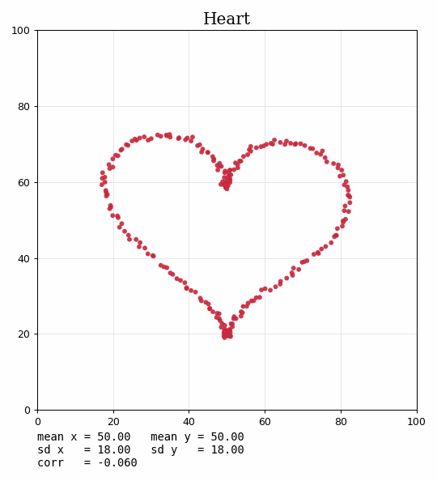

# Same Statistics. Different Stories. ❤️💔

Two bivariate datasets (n = 240 each) with identical summary statistics but completely different shapes: a heart and a broken heart.

## Summary statistics

| Statistic | Heart | Broken heart |
|---|---|---|
| Mean of X | 50.00 | 50.00 |
| Mean of Y | 50.00 | 50.00 |
| SD of X | 18.00 | 18.00 |
| SD of Y | 18.00 | 18.00 |
| Correlation (X, Y) | -0.060 | -0.060 |

## Files
- `heart_data.csv`: columns `x_heart`, `y_heart`, `x_broken`, `y_broken`
- `heart_morph.gif`: animation of one dataset morphing into the other, with statistics recalculated on every frame
- `same_stats_different_stories.ipynb`: Python code (run it in Google Colab)

## How it was made
Each shape was built from a formula (a parametric heart curve, and a zigzag split with the two halves pulled apart for the broken heart). Both datasets were then rescaled with a linear (Cholesky) transformation so that they share exactly the same means, standard deviations and correlation.

## Inspiration
- Anscombe, F. J. (1973). *Graphs in Statistical Analysis.* The American Statistician.
- Matejka, J. & Fitzmaurice, G. (2017). *Same Stats, Different Graphs.* CHI 2017. (Datasaurus Dozen, created from a dataset by Alberto Cairo.)

This is a learning project by Amy Ashish (MSc Statistics with Data Science).
